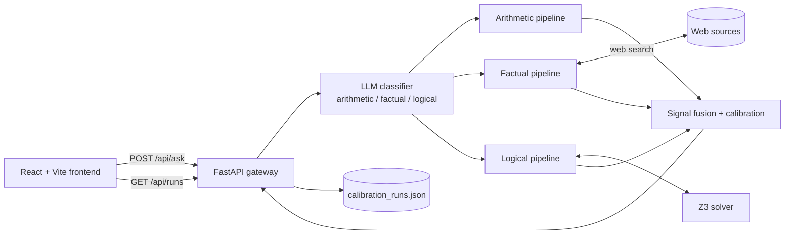

# Calibra: Step-Level Confidence Calibration for LLM Reasoning

## Abstract

Large language models give fluent answers but no reliable signal of when they
are wrong. **Calibra** estimates how confident a system should be in an LLM
answer, and which reasoning step is most likely to be wrong. A gateway
classifies each question as **arithmetic**, **factual** or **logical** and
routes it to a pipeline built for that kind of reasoning. Each pipeline
splits the answer into steps (or atomic claims) and scores every step with
several independent signals:

- **Self-verification**: an LLM judge's probability that the step is true.
- **Sampling consistency**: semantic agreement across resampled continuations.
- **Domain-specific evidence**: token log-probabilities for arithmetic,
  reliability-weighted web evidence for factual claims, and a Z3 theorem
  prover for logic.

The signals are fused into a per-step confidence and aggregated into an
answer-level confidence. The lowest-confidence step is flagged as the
predicted error location. A React dashboard shows each answer, its reasoning
chain and its signals, and the history of all stored runs.

## Objectives

1. Produce an answer-level confidence that tracks real correctness.
2. Locate the reasoning step most likely to contain an error.
3. Use verification signals suited to each reasoning type instead of one
   generic heuristic.
4. Make the confidence explainable: show every signal behind a score.

## Architecture



| Layer | Location | Role |
|---|---|---|
| Frontend | `frontend/` | Ask view and Analytics dashboard (React 19, Recharts) |
| API | `backend/app/` | FastAPI app: `/api/ask`, `/api/runs`, `/api/health`; settings from `.env` |
| Gateway | `gateway/` | Structured-output LLM classifier and router |
| Pipelines | `arithmetic/`, `factual/`, `logical/` | Generation, decomposition, signals, verification, experiments |
| Shared services | `backend/app/services/` | LLM client, consistency metrics, fusion, XGBoost calibrator, run store |
| Persistence | `backend/data/calibration_runs.json` | Every answered question with its full pipeline output and per-step signals |

**Models:** `gpt-4o-mini` for reasoning, verification and classification;
`gpt-4.1-mini` with the web-search tool for factual retrieval. Both are
configurable.

## Pipelines

### Arithmetic (GSM8K-style word problems)
1. The LLM writes a numbered step-by-step solution.
2. For each step, 5 alternative next steps are sampled (temperature 0.8,
   with token log-probabilities).
3. A verifier LLM returns `p_true` for the step and groups the samples by
   meaning. This gives consistency (share of the largest group) and
   semantic entropy.
4. The signals are fused with weights that depend on the step type
   (verification, consistency, token probability):
   - calculation: 0.35 / 0.40 / 0.25
   - logical and setup steps: 0.50 / 0.30 / 0.20
5. An optional XGBoost step calibrator (`P(step_correct)`) can replace this
   weighted fusion once trained. The training script reports ECE, MCE,
   Brier score, NLL and AUROC. Until a model is trained, outputs are labelled
   `type_adaptive_weighted_proxy`.

### Factual (open-domain questions)
1. The LLM writes an answer, which is split into steps and then into atomic
   claims.
2. **Retrieval:** each claim is web-searched. When the search snippet isn't
   relevant enough, the cited page is fetched for a better excerpt.
3. **Source reliability:** a domain policy with 22 tiers gives each source a
   score, from government (0.97) and academic sites through news and blogs
   down to social media (0.30). Sources are then marked KEEP (≥ 0.75),
   DOWN_WEIGHT (≥ 0.45) or REJECT; rejected sources are dropped.
4. **Verification:** the LLM judges each evidence passage as
   SUPPORT / CONTRADICT / UNKNOWN. The evidence score sums these verdicts,
   each weighted by reliability × relevance.
5. Signals are fused (self-verification 0.4, consistency 0.3, evidence 0.3)
   and passed through a fixed sigmoid, `σ(−1 + 3.2·f)`. The answer
   confidence is the **geometric mean over the essential claims**, so a
   single weak essential claim lowers the whole answer.

### Logical (deduction from supplied premises; RuleTaker-style)
1. Premises and rules are extracted from the text. Pronouns such as
   "something / it / they" become variables, and generic plurals ("Red
   things are big") and conjunctions ("green and cold") are handled.
2. **The Z3 SMT solver decides the verdict**: ENTAILED, CONTRADICTED or
   UNKNOWN (open-world). It also detects inconsistent premises and reports
   the premises and rules it used.
3. A forward-chaining rule engine builds a readable proof. The reasoning
   steps are only the facts on the proof path of the queried fact.
4. Logical validity (the solver's checks), LLM self-verification and
   sampling consistency are fused and calibrated as in the factual pipeline.

## Frontend

- **Ask view:**
  - An animated confidence gauge with High / Moderate / Low bands.
  - Charts of confidence per step and of the signal breakdown; the flagged
    error step is highlighted.
  - The reasoning chain, with verdicts, sources (and their reliability) and
    the verifier's rationale.
  - The premise and rule base for logical questions.
  - A searchable, collapsible view of the raw JSON response.
- **Analytics view:** built from all stored runs.
  - Summary figures: number of runs, mean confidence, claims supported,
    low-confidence runs.
  - Charts of confidence over time, the confidence distribution, confidence
    by step position, and claim verdicts by pipeline.
  - A searchable run history; any past run opens in the same detailed view.
- Light and dark themes, a colour palette chosen to stay readable for
  colour-blind viewers, and a layout that works on phones.

## Experiments and Results so far

| Pipeline | Dataset | Status |
|---|---|---|
| Arithmetic | GSM8K test, 5-question pilot | Pipeline runs end to end; per-step signals recorded |
| Factual | TriviaQA (rc.nocontext, validation), first 100 selected, 40 completed | Retrieval, reliability and claim verification run end to end |
| Logical | RuleTaker test, first 100 convertible questions, 44 completed | Verdict accuracy **29/44 (66%)** in the pilot run. **33/44 (75%)** when re-checked offline after the rule-parser fix (verdicts need no LLM calls). |

**What we've learned so far:**
- **Parser bug found by the logical pilot:** rule extraction missed
  RuleTaker's "something … it" phrasing and generic plurals, so no rules
  were applied and nearly every answer came from directly stated facts. Now
  fixed. All 11 remaining misses are closed-world negations (e.g. "Is Bob
  not quiet?"), which the open-world solver correctly reports as UNKNOWN.
- **Confidence barely separates right from wrong answers yet:** in the
  logical pilot, mean confidence was 0.48 for correct answers vs 0.46 for
  wrong ones. Next-step sampling disagrees whenever many valid steps exist,
  which pulls down consistency even for answers stated outright in the
  premises.
- **Formulas still hand-tuned:** the sigmoid and fusion weights are not yet
  fitted to data, and outputs say so (`fixed_sigmoid_not_empirically_calibrated`).

## Testing

105 automated tests (pytest) cover every pipeline, the gateway, the API, the
source-reliability bands, the rule parser, and how proof steps are selected.
LLM calls are replaced with stubs, so the suite runs offline in about 10 s.

## Limitations and Next Steps

- Fit the calibration to labelled step data: train the XGBoost calibrator
  and fit the sigmoid and fusion weights, then report ECE, Brier score and
  AUROC per pipeline.
- Replace next-step sampling for logical questions with sampling of the whole
  answer, so that consistency reflects agreement on the conclusion.
- Add an optional closed-world mode to match the RuleTaker labels.
- Finish the pilot runs (factual 100, logical 100, GSM8K at scale) and
  measure error localisation against injected errors (`arithmetic/data/error_injection.py`).
- Hidden-state and attention signals need a locally hosted model; the
  OpenAI API exposes only token log-probabilities.

## Running

```powershell
# backend (repo root)
.\venv\Scripts\Activate.ps1
Set-Location backend; python -m uvicorn app.main:app --reload
# frontend (second terminal)
Set-Location frontend; npm run dev        # http://localhost:5173
```

Configuration goes in the root `.env`: `LLM_API_KEY`, `LLM_MODEL`,
`FACTUAL_SEARCH_MODEL`, `CONSISTENCY_SAMPLES`, `STEP_CALIBRATOR_PATH`.
